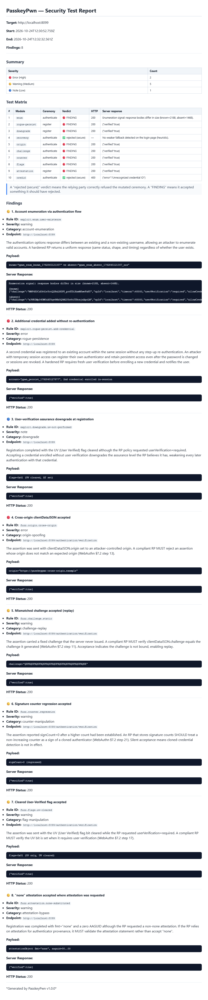

<div align="center">
  <pre aria-hidden="true">╭───╮
│ ◉ ╰━━━━┳━━┓
╰───╯    ╹  ╹</pre>
  <h1>PasskeyPwn</h1>
  <p><strong>Black-box security testing for WebAuthn relying parties</strong></p>
  <p>Record a passkey baseline, evaluate server-side validation, and turn saved results into a report.</p>
  <p>
    
    
    
  </p>
  <p>
    <a href="#install">Install</a> ·
    <a href="#usage">Usage</a> ·
    <a href="#modules">Modules</a> ·
    <a href="#output">Report preview</a> ·
    <a href="#limitations">Limitations</a>
  </p>
</div>

---

> [!IMPORTANT]
> Use PasskeyPwn only against systems you own or have explicit permission to test.

---

## Workflow at a glance

| Stage | What it produces |
| --- | --- |
| `recon` | A `baseline.json` file with the observed registration and authentication configuration |
| `fuzz` and `exploit` | Run files with case verdicts, findings, and available evidence |
| `report` | An HTML, Markdown, or SARIF report from saved run files |

---

## Modules

### `fuzz` — per-field validation (ceremony conformance)

| Module | Mutation | A secure RP… |
|---|---|---|
| `origin` | `clientDataJSON.origin` set to an attacker origin | rejects (WebAuthn §7.2 step 13) |
| `challenge` | fixed / unissued challenge | rejects (challenge binding, replay) |
| `counter` | signature counter regressed to 0 | flags cloned authenticator (§7.2 step 21) |
| `flags` | UV bit cleared while UV was required | rejects (§7.2 step 17) |
| `attestation` | `"none"` attestation where attestation was requested | validates, not accepts |
| `attestation-packed` | packed attestation with bad signature | rejects |
| `credid` | assertion from an unregistered credential ID | rejects (unknown credential) |
| `rpid-scope` | rpId scope confusion (parent/foreign domain) | rejects (§7.2 step 15) |
| `cdj-type` | wrong `clientDataJSON.type` | rejects (§7.2 step 11) |
| `cdj-crossorigin` | `crossOrigin=true` | rejects (phishing resistance) |
| `cdj-dupkey` | duplicate `challenge` key (parser confusion) | rejects |
| `cdj-trailing` | trailing bytes after clientDataJSON | rejects |
| `flags-backup` | invalid BE/BS combo (BS set, BE clear) | rejects (§6.1.3) |

### `exploit` — higher-level relying-party weaknesses

| Module | Checks whether the RP… |
|---|---|
| `enum` | leaks account/credential existence via the auth options response |
| `rogue-persist` | lets a new credential be enrolled with no re-authentication (persistence vector) |
| `downgrade` | accepts a credential enrolled without user verification when UV is required |
| `recovery` | exposes a weaker non-passkey fallback that bypasses the passkey |
| `cred-binding` | binds a credential to one account (cross-account reuse) |

The `exploit` command **requires** an explicit `--authorized "<statement>"` flag, recorded in results as an audit trail.

---

## How it works

- **Shadow authenticator** — injects a full override of `navigator.credentials.create/get` so every byte of `authenticatorData`, `clientDataJSON`, the attestation object, and the signature is built and signed in Node (ES256 / RS256 / EdDSA).
- **Capture-replay (`--mode replay`)** — captures one real ceremony (the `options` + `finish` HTTP calls, with cookies/CSRF), then for each mutation rebuilds + **re-signs** the components and replays the `finish` request directly over HTTP. A structural **field locator** finds the WebAuthn fields inside *any* JSON envelope by decoding and recognizing them — so replay is target-agnostic.
- **Browser mode (`--mode browser`)** — drives the mutation through the live page for cases that are not replayable (e.g. registration-time attestation).
- **HAR import (`--from-har`)** — replay from a captured HAR/Burp export instead of driving the browser.

---

## Install

```bash
npm install
npx playwright install chromium
npm run build        # compile to dist/ (or use `npm run dev` / tsx for source)
```

Requires Node ≥ 20.

## Usage

```bash
# 1. Recon — register + authenticate once, record the baseline
npx tsx src/cli.ts recon \
  --url-register https://target.example --url-login https://target.example \
  --screenshots ./evidence --out ./baseline.json

# 2. Fuzz — mutate each field and check the server's verdict (HTTP replay)
npx tsx src/cli.ts fuzz \
  --module "origin,challenge,counter,flags,attestation,credid" \
  --mode replay --baseline ./baseline.json --out ./results

# 3. Exploit — higher-level weakness probes (authorization required)
npx tsx src/cli.ts exploit \
  --module "enum,rogue-persist,downgrade,recovery,cred-binding" \
  --authorized "I am authorized to test target.example under program XYZ" \
  --baseline ./baseline.json --out ./results

# 4. Report — render findings as Markdown, SARIF or HTML
npx tsx src/cli.ts report --format md   --results ./results --out report.md
npx tsx src/cli.ts report --format sarif --results ./results --out report.sarif
npx tsx src/cli.ts report --format html  --results ./results --out report.html
```

Global options: `--proxy http://127.0.0.1:8080` (route through Burp), `--no-headless` (watch the browser), `--screenshots <dir>` (evidence capture).

> ⚠️ **Report contents.** Result files and reports include excerpts of the server's HTTP responses, which may contain sensitive data. Treat `results/` and generated reports as sensitive. (Request cookies / session tokens are **not** persisted — they stay in memory only.)

---

## Output

| Format | What you get |
| --- | --- |
| **HTML** | A standalone report with a severity summary, test matrix, and finding details |
| **Markdown** | A text report with the test matrix and finding details for review or writeups |
| **SARIF** | Structured findings for CI and code-scanning tools |

<p align="center">
  <a href="demo-vuln/screenshots/08-report.png">
    
  </a>
</p>

[Browse the sample Markdown report](demo-vuln/report.md).

---

## Vulnerable testbed

`testbed/vulnerable-rp.ts` is an **intentionally insecure** WebAuthn relying party for exercising PasskeyPwn and for demos. It binds to `localhost` only and deliberately skips origin / challenge / counter / UV / attestation checks (each toggleable via `PPWN_CHECK_*=1`) while still verifying the signature and credential ID.

```bash
npx tsx testbed/vulnerable-rp.ts          # http://localhost:8099
# then point recon/fuzz/exploit at http://localhost:8099
```

> ⚠️ **Never deploy the testbed.** It is broken on purpose.

The checked-in [demo report](demo-vuln/report.md) records **8 findings across 10 cases** from the local testbed. Those counts describe the saved demo run.

---

## Project layout

```
src/
  cli.ts                     CLI entry + subcommand registration
  cli-commands/              recon | fuzz | exploit | report
  core/
    cbor-builder.ts          authenticatorData / clientDataJSON / attestationObject / COSE (canonical CBOR)
    signer.ts                ES256 / RS256 / EdDSA keygen + signing
    shadow-authenticator.ts  full navigator.credentials override
    baseline-authenticator.ts CDP virtual authenticator (recon only)
    cdp-session.ts           browser lifecycle, robust navigation, screenshots
    ceremony-runner.ts       drive a ceremony on a page, classify the verdict
    webauthn-locator.ts      structural WebAuthn-field locator (envelope-agnostic)
    replay.ts                capture-mutate-replay engine (cookie-jar aware)
    har-import.ts            HAR/Burp export → ceremony transcript
  modules/                   recon | fuzz | exploit engines
  reporting/                 SARIF + Markdown + HTML writers, shared results store
testbed/vulnerable-rp.ts     intentionally insecure RP for testing
```

---

## Limitations

- Replay currently supports JSON `finish` endpoints; form-encoded / non-JSON envelopes fall back to browser mode or are unsupported.
- `attestation` is exercised in browser mode (registration ceremony), not via replay.
- `rogue-persist` flags credential enrollment without re-auth; on **stateless demos with no account model** (e.g. webauthn.io) this is not a real vulnerability — verify the target has an authenticated account/session model before treating it as one.
- Recon's live-policy capture (RP ID / UV / attestation preference) can be flaky on some SPAs; the ceremony itself still runs. Verdicts from `fuzz --mode replay` and `exploit` are based on real HTTP status and are reliable.
- The `--authorized` gate is an audit record, not an access control.

---

## Responsible use

PasskeyPwn is for authorized security testing, research, and CTF/education. Do not use it against systems you do not own or lack written permission to test. Unauthorized testing may be illegal.

## License

ISC. See `package.json`.
